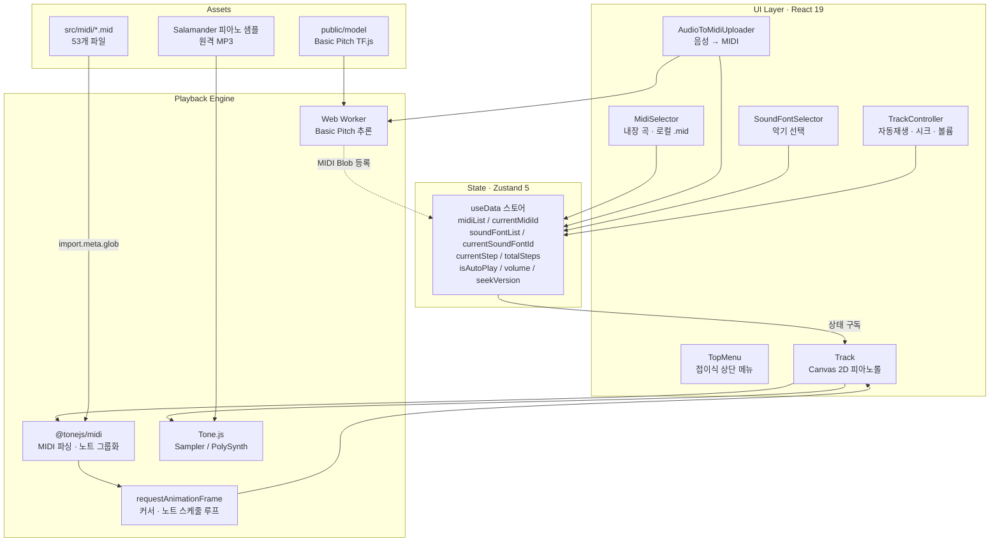
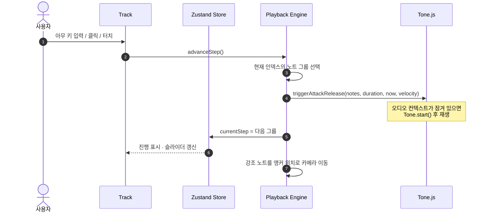
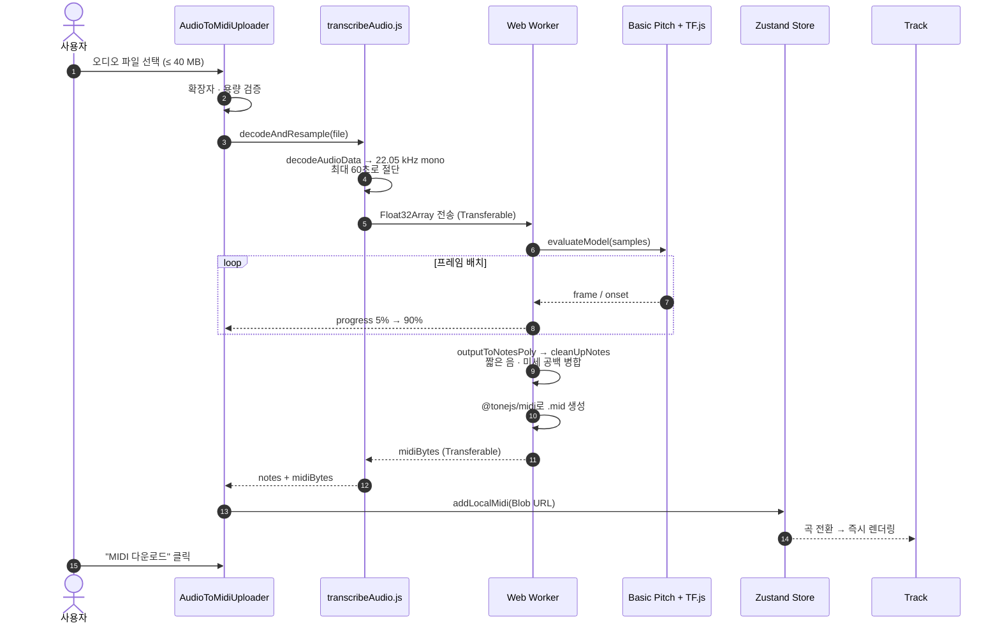
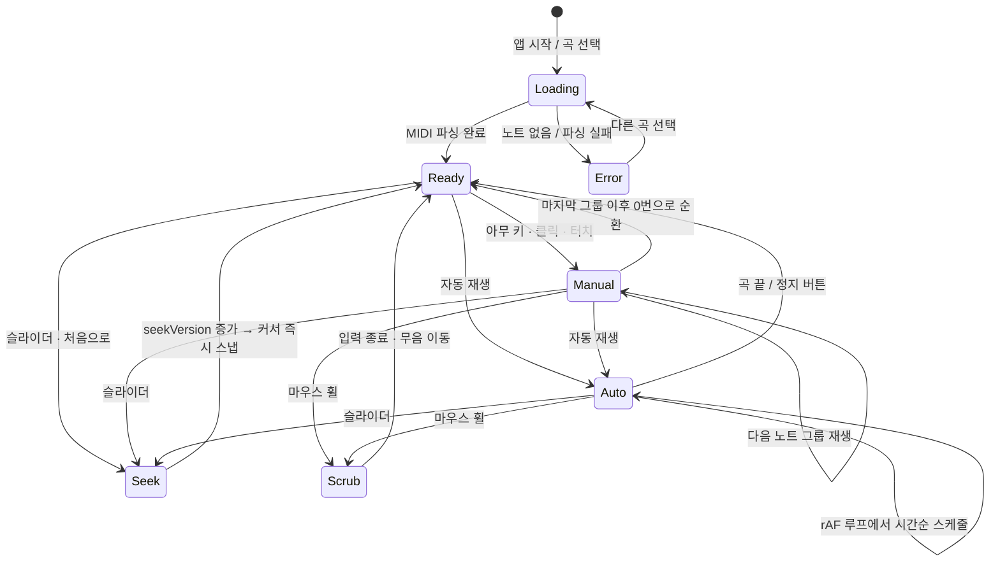
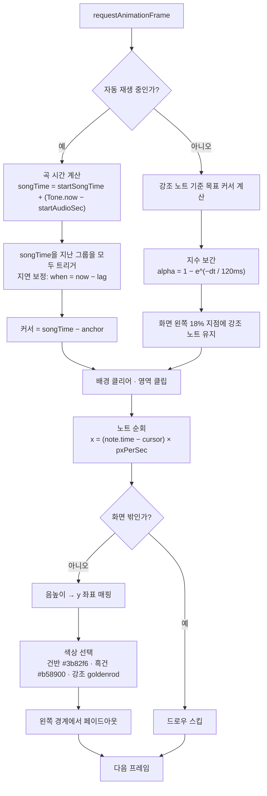

<div align="center">

# 🎹 FreeTempo

**박자를 세지 말고, 음을 따라가세요.**

브라우저에서 바로 즐기는 자유 박자(free tempo) 피아노 연주 · 악보 읽기 연습기

[](https://devtoxa.github.io/project-freetempo2/)
[](https://react.dev/)
[](https://vite.dev/)
[](https://tonejs.github.io/)
[](https://zustand.docs.pmnd.rs/)
[](https://www.tensorflow.org/js)

[**라이브 데모**](https://devtoxa.github.io/project-freetempo2/) · [개요](#개요) · [아키텍처](#아키텍처) · [시작하기](#시작하기) · [사용법](#사용법)

</div>

---

## 개요

**FreeTempo**는 피아노 롤(piano roll)이 화면을 가로질러 흐르고, 사용자가 **아무 키나 누르거나 화면을 탭할 때마다 다음 음(노트 그룹)으로 넘어가는** 웹 앱입니다.

BPM에 맞춰 자동으로 흘러가는 리듬 게임과 달리, 연주 속도를 전적으로 사용자가 정합니다. 점수도, 콤보도, 판정도 없습니다. 대신

- 다음에 눌러야 할 음이 항상 화면 왼쪽 18% 지점에 강조되어 있고,
- 손이 준비되면 아무 키나 눌러 그 음을 소리 내고 다음 음으로 넘어갑니다.

즉, **악보 읽기(초견)와 손가락 위치 연습**에 집중하기 위한 도구입니다. 설치나 회원가입 없이 브라우저만 있으면 됩니다.

### 왜 FreeTempo인가요?

| | 일반적인 피아노 롤 앱 | **FreeTempo** |
| --- | --- | --- |
| 진행 방식 | 정해진 BPM·박자에 맞춰 자동 진행 | 사용자가 키 입력으로 직접 진행 |
| 판정 | 정확도·콤보·점수 | 판정 없음 |
| 목적 | 리듬 게임, 반주 따라가기 | 악보 읽기, 초견, 손가락 위치 익히기 |
| 준비물 | 설치, 계정, 사운드 설정 | 최신 브라우저 하나 |

---

## 주요 기능

| 기능 | 설명 |
| --- | --- |
| 🎼 **자유 박자 진행** | 아무 키 · 클릭 · 터치로 다음 노트 그룹 재생. 속도 제한 없음 |
| 🖼️ **Canvas 2D 피아노롤** | DPR 대응 고해상도 렌더링, 부드러운 가상 카메라 스크롤 |
| ▶️ **자동 재생** | 곡의 BPM과 노트 타이밍에 맞춰 자동 스케줄링. 정지·재개·구간 이동 지원 |
| 🎹 **4가지 악기** | Salamander 피아노 샘플러 + Synth / Electric Piano(FM) / Soft Synth(AM) |
| 🎵 **내장 클래식 50곡** | Bach, Beethoven, Chopin, Debussy, Mozart 등 53개 MIDI 파일 수록 |
| 📂 **로컬 MIDI 로드** | 파일 선택으로 `.mid`를 추가해 즉시 재생 |
| 🎤 **음성 → MIDI 변환** | Spotify **Basic Pitch** + TensorFlow.js로 브라우저 안에서 채보 |
| 🖱️ **휠 스크럽** | 마우스 휠로 소리 없이 앞뒤 위치 이동 |
| 🔊 **볼륨 제어** | −40 dB ~ 0 dB 실시간 반영 |
| 📱 **QR 코드** | 배포된 사이트로 바로 연결되는 QR 코드 화면 표시 |

---

## 아키텍처

React 컴포넌트는 **UI**, Zustand는 **단일 상태 저장소**, `Track`은 **렌더링 + 재생 엔진**을 담당합니다.



**레이어별 역할**

- **UI Layer** — `TopMenu`가 `Info`, 선택기, `TrackController`를 묶는 접이식 패널. `Track`은 화면 전체를 덮는 캔버스와 재생을 담당합니다.
- **State** — 곡 목록, 악기, 재생 위치, 자동 재생 여부, 볼륨을 한 곳에서 관리하고 모든 컴포넌트가 선택적으로 구독합니다.
- **Engine** — MIDI를 파싱해 시간순 노트와 "동시에 울리는 노트 그룹"으로 변환하고, 렌더 루프에서 카메라 이동과 오디오 트리거를 함께 처리합니다.

### 요청에서 소리까지



---

## 음성에서 MIDI로

업로드한 오디오는 **메인 스레드가 아닌 Web Worker**에서 분석됩니다. 모델 추론 중에도 캔버스와 UI는 멈추지 않습니다.



**변환 규칙**

| 항목 | 값 | 의미 |
| --- | --- | --- |
| 샘플레이트 | 22,050 Hz · mono | Basic Pitch 입력 규격 |
| 최대 길이 | 60초 | 초과분은 앞 60초만 변환 |
| 최대 파일 | 40 MB | 브라우저 메모리 보호 |
| 최소 음 길이 | 130 ms | 지나치게 짧은 노이즈 제거 |
| 진폭 임계값 | 0.06 | 약한 배경음 무시 |
| 노트 병합 간격 | 60 ms | 같은 음높이의 끊긴 소리 연결 |
| 생성 MIDI BPM | 120 | 결과 파일의 기본 템포 |

---

## 재생 상태



- **Manual** — 입력할 때마다 한 그룹씩 전진하며, 자동 재생 중이었다면 즉시 해제됩니다.
- **Auto** — `Tone.now()` 기준으로 곡 시간을 계산해 밀린 노트까지 따라잡습니다.
- **Seek** — `seekVersion`을 증가시켜 렌더 루프와 경합하지 않도록 커서를 동기화합니다.
- **Scrub** — 휠 입력 동안 자동 재생을 멈추고 소리를 해제해, 조용히 위치만 옮깁니다.

---

## 렌더링 루프

`Track`은 `requestAnimationFrame` 루프 하나에서 **카메라 이동, 노트 스케줄링, 캔버스 드로우**를 모두 처리합니다.



| 색상 | 의미 |
| --- | --- |
| 🔵 `#3b82f6` | 건반(내추럴) 노트 |
| 🟠 `#b58900` | 올림표(`#`) 노트 |
| 🟡 `goldenrod` + `#fff8cc` 테두리 | 지금 재생 중인 노트 그룹 |
| ⬛ `#000000` | 배경 |

> 지나간 노트는 즉시 사라지지 않고 왼쪽 경계에서 약 60px에 걸쳐 서서히 사라져, 방금 연 음의 흐름을 눈으로 확인할 수 있습니다.

---

## 프로젝트 구조

```text
project-freetempo2/
├─ index.html                        # 루트 HTML (🎹 파비콘, #root)
├─ vite.config.js                    # GitHub Pages base: '/project-freetempo2/'
├─ package.json                      # dev / build / deploy 스크립트
├─ eslint.config.js
├─ scripts/
│  └─ copy-basic-pitch-model.mjs     # Basic Pitch 모델 → public/model 복사
├─ py-qr-code/
│  └─ main.py                        # segno로 배포 URL QR 생성 → src/qr.png
├─ public/
│  ├─ favicon.svg
│  ├─ icons.svg
│  └─ model/                         # (gitignore) TF.js 모델, dev/build 시 생성
└─ src/
   ├─ main.jsx                       # React 19 루트 렌더링
   ├─ App.jsx                        # Freetempo 마운트
   ├─ App.css                        # 전체 화면 레이아웃 · 메뉴 · QR 스타일
   ├─ index.css
   ├─ qr.png                         # 배포 URL QR 코드
   ├─ audio/
   │  ├─ synthMap.js                 # synth / fm / am → Tone.js Voice 매핑
   │  └─ transcribeAudio.js          # 디코딩 · 리샘플 · Worker 통신
   ├─ components/
   │  ├─ Freetempo.jsx               # 화면 루트 레이아웃
   │  ├─ TopMenu.jsx                 # 접이식 상단 메뉴
   │  ├─ Info.jsx                    # 현재 곡 제목 · 아티스트 · URL
   │  ├─ MidiSelector.jsx            # 내장 곡 선택 / 로컬 .mid 로드
   │  ├─ AudioToMidiUploader.jsx     # 음성 → MIDI 업로드 UI
   │  ├─ SoundFontSelector.jsx       # 악기 선택
   │  ├─ TrackController.jsx         # 자동재생 · 위치 · 볼륨
   │  └─ Track.jsx                   # Canvas 렌더러 + Tone.js 재생 엔진
   ├─ midi/                          # 클래식 MIDI 53개
   ├─ stores/
   │  └─ useData.jsx                 # Zustand 스토어 (곡 · 악기 · 재생 상태)
   └─ workers/
      └─ transcribe.worker.js        # Basic Pitch 추론 + MIDI 바이트 생성
```

---

## 기술 스택

| 라이브러리 | 버전 | 역할 |
| --- | --- | --- |
| [React](https://react.dev/) | 19 | UI 컴포넌트, 상태 구독 |
| [Vite](https://vite.dev/) | 8 | 개발 서버, 정적 빌드, GitHub Pages 배포 |
| [Tone.js](https://tonejs.github.io/) | 15 | 신디사이저 · 샘플러 · 오디오 스케줄링 |
| [@tonejs/midi](https://github.com/Tonejs/Midi) | 2.0 | MIDI 파일 파싱 및 생성 |
| [Zustand](https://zustand.docs.pmnd.rs/) | 5 | 경량 전역 상태 관리 |
| [@spotify/basic-pitch](https://github.com/spotify/basic-pitch) | 1.0 | 오디오 → 노트(피치) 추론 |
| [TensorFlow.js](https://www.tensorflow.org/js) | 3.21 | 브라우저 내 모델 추론 (CPU 백엔드) |
| [ESLint](https://eslint.org/) | 10 | 코드 정적 분석 |
| [gh-pages](https://github.com/tschaub/gh-pages) | 6 | `dist/` → GitHub Pages 배포 |

---

## 시작하기

### 요구 사항

- **Node.js 20.19+** 또는 **22.12+** (Vite 8 기준)
- **npm**
- 최신 Chromium · Firefox · Safari (Web Audio API, Web Worker, OfflineAudioContext 필요)

### 설치 및 실행

```bash
npm install
npm run dev
```

`predev` 훅이 `scripts/copy-basic-pitch-model.mjs`를 실행해 `node_modules/@spotify/basic-pitch/model`을 `public/model`로 복사합니다. 이 폴더는 `.gitignore`에 포함되어 있어 저장소에는 커밋되지 않습니다.

### 스크립트

| 명령 | 설명 |
| --- | --- |
| `npm run dev` | Basic Pitch 모델 복사 후 Vite 개발 서버 실행 |
| `npm run build` | 모델 복사 후 `dist/` 프로덕션 빌드 |
| `npm run preview` | 빌드 결과를 로컬에서 미리보기 |
| `npm run lint` | ESLint 검사 |
| `npm run deploy` | `predeploy`(빌드) → `gh-pages -d dist` 배포 |
| `npm run copy-model` | Basic Pitch 모델 자산만 수동 복사 |

### GitHub Pages 배포

`vite.config.js`의 `base`가 저장소 이름(`/project-freetempo2/`)으로 고정되어 있습니다. 다른 저장소에 배포할 경우 이 값을 함께 변경하세요.

```bash
npm run deploy
```

배포 주소: **https://devtoxa.github.io/project-freetempo2/**

---

## 사용법

앱을 열면 검은 화면 위로 피아노롤이 흐르고, 화면 상단 중앙의 **`메뉴 ☰`** 버튼으로 모든 컨트롤을 열 수 있습니다.

```text
┌──────────────────────────────────────────────────────┐
│                    [ 메뉴 ☰ ]                        │
│                                                      │
│    ████          ████   ████           ████          │
│         ████                  ████            ████   │
│    ──▲──────────────────────────────────────────     │
│      │                                               │
│   강조 노트                                    ▣ QR │
└──────────────────────────────────────────────────────┘
```

| 조작 | 동작 |
| --- | --- |
| **아무 키 입력** | 다음 노트 그룹을 소리 내고 전진 |
| **캔버스 클릭 / 터치** | 다음 노트 그룹을 소리 내고 전진 |
| **마우스 휠** | 소리 없이 앞뒤로 이동 (자동 재생 중지) |
| **자동 재생 / 정지** | 곡의 BPM에 맞춰 자동 진행 |
| **처음으로** | 첫 노트 그룹으로 이동 |
| **위치 슬라이더** | 원하는 노트 그룹으로 즉시 이동 |
| **볼륨 슬라이더** | −40 dB ~ 0 dB |
| **사운드 선택** | Salamander Piano · Synth · Electric Piano · Soft Synth |
| **[.mid 파일 로드]** | 로컬 `.mid` 파일을 목록에 추가 |
| **[음성 → MIDI]** | 40 MB 이하 오디오를 최대 60초까지 채보 후 재생·다운로드 |

> 텍스트 입력, 셀렉트, 텍스트영역에 포커스가 있을 때는 키 입력이 연주로 전달되지 않습니다.

---

## 동작 원리

### 1. 노트 그룹화

MIDI의 모든 트랙에서 노트를 추출한 뒤, **그룹의 첫 노트와 시작 시각 차이가 0.02초 이내**인 노트를 같은 그룹으로 묶습니다. 화음은 한 번의 입력으로 함께 울리고, 화면에서도 함께 강조됩니다.

```js
// src/components/Track.jsx
const THRESHOLD = 0.02; // 초
// note.time이 그룹의 첫 노트와 20ms 이내면 같은 그룹
```

### 2. 시간 → 화면 좌표

```text
pxPerSec = (BPM / 60) × pixelsPerBeat      // 기본 pixelsPerBeat = 80
x        = 패딩 + (note.time − displayCursorTime) × pxPerSec
y        = 상단 + (1 − (midi − minMidi) / (maxMidi − minMidi)) × 가용 높이
```

BPM이 높을수록 노트가 화면에서 더 빠르게 흐릅니다. 기본값은 80 px/beat입니다.

### 3. 카메라 스크롤

재생 중인 노트 그룹은 항상 화면 왼쪽 **18%** 지점에 오도록 `displayCursorTime`을 이동시킵니다. 매 프레임 지수 보간을 적용해(시정수 120 ms) 커서가 부드럽게 따라가며, 시크처럼 즉시 이동해야 할 때만 스냅합니다.

### 4. 자동 재생 스케줄링

렌더 루프에서 `songTime`을 계산하고, 아직 트리거되지 않은 그룹을 시간순으로 모두 재생합니다. 프레임이 밀려 지연된 경우 `when = now − lag`로 보정해 박자가 누적해서 어긋나지 않게 합니다.

```text
songTime = startSongTime + (Tone.now() − startAudioSec)
while (songTime >= group.time) → trigger(group)
```

탭이 백그라운드로 가면 `requestAnimationFrame`이 멈추므로, `visibilitychange` 이벤트에서 경과 시간을 반영해 복귀 위치를 재계산합니다.

### 5. 오디오 컨텍스트

브라우저 정책상 오디오는 사용자 제스처 이후에만 시작할 수 있습니다. 첫 재생 시 `Tone.getContext().state`를 확인하고, 필요하면 `Tone.start()`를 호출합니다. Salamander 샘플러는 원격 MP3를 사용하므로 첫 재생 전에 `Tone.loaded()`를 기다립니다.

---

## 제약 사항 & 팁

- **음성 → MIDI는 최대 60초**까지만 변환합니다. 긴 녹음은 앞부분만 사용됩니다.
- **첫 변환은 느립니다.** Basic Pitch 모델(수 MB)을 내려받기 때문이며, 이후에는 캐시됩니다.
- **CPU 백엔드**로 추론하므로 변환 속도는 기기 성능에 따라 달라집니다. 그래도 Web Worker에서 실행되어 UI는 멈추지 않습니다.
- **Salamander 피아노**는 원격 샘플을 사용합니다. 오프라인에서는 Synth 계열 악기를 사용하세요.
- **모바일 브라우저**는 첫 터치 이후에 소리가 납니다. 화면을 한 번 탭한 뒤 사용하세요.
- **단일 악기로 재생**합니다. MIDI의 트랙별 악기 분리는 지원하지 않고, 모든 노트를 하나의 악기로 합쳐 연주합니다.
- **곡 추가**는 `src/midi/`에 파일을 넣고 `src/stores/useData.jsx`의 `midiList`에 항목을 추가하면 됩니다. 파일명과 `url`이 일치해야 합니다.
- **QR 코드**는 `py-qr-code/main.py`의 `segno`로 생성합니다.

  ```bash
  pip install segno
  cd py-qr-code
  python main.py   # ../src/qr.png 생성
  ```

---

## 크레딧

- **Basic Pitch** — Spotify Audio Intelligence Lab ([@spotify/basic-pitch](https://github.com/spotify/basic-pitch))
- **Tone.js** — Yotam Mann 외 ([tonejs.github.io](https://tonejs.github.io/))
- **Salamander Grand Piano** — Alexander Holm의 피아노 샘플
- **수록 곡** — Bach, Beethoven, Chopin, Debussy, Fauré, Grieg, Handel, Haydn, Liszt, Mendelssohn, Mozart, Purcell, Satie, Scarlatti, Schubert, Schumann, Tchaikovsky 등 퍼블릭 도메인 클래식
- **QR 코드** — [segno](https://github.com/heuer/segno)

---

## 라이선스

이 저장소에는 별도의 `LICENSE` 파일이 없습니다. 코드를 재사용하거나 배포할 계획이라면 라이선스를 명시하는 것을 권장합니다.
